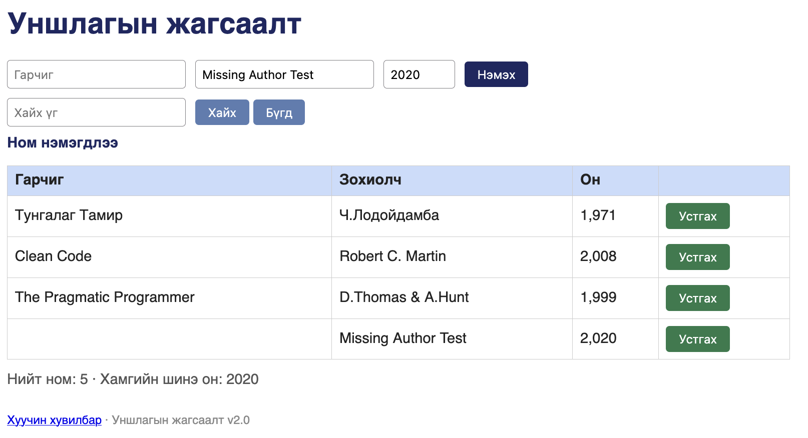
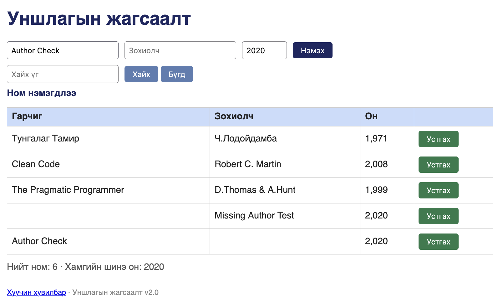

# BUG-01 — Заавал бөглөх талбар хоосон байхад номын бүртгэл үүсдэг

- **Ноцтой байдал:** Ноцтой (Major) — заавал бөглөх мэдээлэлгүй ном бүртгэгдэж байна.
- **Ангилал:** Оролтын баталгаажуулалт, өгөгдлийн бүрэн бүтэн байдал
- **Аялал:** Couch Potato

## Орчин

- Апп: «Уншлагын жагсаалт» v2.0
- Хөтөч: Firefox 160.0.1, macOS
- Дахин шалгасан огноо: 2026-11-25
- Хаяг: `http://localhost:3000`

## Дахин гаргах алхам

1. Аппыг шинээр асааж, анхны гурван номтой жагсаалтыг нээнэ.
2. «Гарчиг»-ийг хоосон үлдээж, «Зохиолч»-д `Missing Author Test`, «Он»-д `2020` оруулна.
3. «Нэмэх» товчийг дарж, мэдэгдэл болон хүснэгтийг шалгана.

Зохиогчийн талбарыг шалгахдаа аппыг шинээр асааж, «Гарчиг»-т `Author Check`, «Он»-д `2020` оруулна. «Зохиолч»-ийг хоосон үлдээгээд «Нэмэх» товчийг дарна.

## Хүлээгдсэн үр дүн

Гурван талбар заавал бөглөгдөх ёстой. Апп дутуу мэдээллийн тухай мэдэгдэж, шинэ мөр нэмэхгүй байх ёстой.

## Бодит үр дүн

Апп хоёр тохиолдолд хоёуланд нь «Ном нэмэгдлээ» гэж мэдэгдсэн. Эхний тохиолдолд гарчиггүй, зохиогч нь `Missing Author Test` гэсэн мөр нэмэгдсэн. Дараагийн тохиолдолд `Author Check` гарчигтай, зохиогчгүй мөр нэмэгдсэн. Өмнөх туршилтаар бүх талбарыг хоосон илгээхэд гарчиг, зохиолчгүй, он нь `0` гэсэн бүртгэл үүсэж байсан.

## Нотлох баримт

[Туршилтын тайлан, 22:48 ба 22:50](../session-report.md) · [Өмнөх зураг](../screenshots/empty-books.png) · [Өмнөх туршилтын тэмдэглэл](../session-notes.txt)
