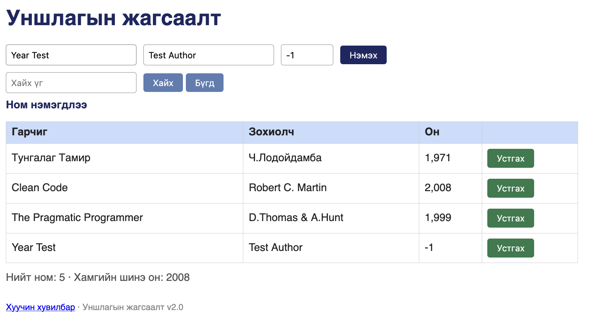

# BUG-02 — Зөвшөөрсөн хүрээнээс гадуурх онтой ном нэмэгддэг

- **Ноцтой байдал:** Ноцтой (Major) — зөвшөөрөгдөөгүй он номын мэдээлэлд бүртгэгдэж байна.
- **Ангилал:** Оролтын баталгаажуулалт, өгөгдлийн бүрэн бүтэн байдал
- **Аялал:** Couch Potato

## Орчин

- Апп: «Уншлагын жагсаалт» v2.0
- Хөтөч: Firefox 160.0.1, macOS
- Дахин шалгасан огноо: 2026-11-25
- Хаяг: `http://localhost:3000`

## Дахин гаргах алхам

1. Аппыг шинээр асааж, анхны гурван номтой жагсаалтыг нээнэ.
2. «Гарчиг»-т `Year Test`, «Зохиолч»-д `Test Author`, «Он»-д `-1` оруулна.
3. «Нэмэх» товчийг дарж, мэдэгдэл болон хүснэгтийг шалгана.

Хязгаарын утгыг шалгахдаа `Year 999`, `Year 1000`, `Year 2100`, `Year 2101` гэсэн өөр өөр гарчиг ашиглана. «Зохиолч»-д `Boundary Test`, «Он»-д гарчиг дахь тоог оруулж тус бүрийг нэмнэ.

## Хүлээгдсэн үр дүн

Хэвлэгдсэн он 1000–2100 хоорондох бүхэл тоо байх ёстой. `1000` болон `2100`-ыг зөвшөөрч, `-1`, `999`, `2101` утгад шинэ мөр нэмэхээс татгалзах ёстой.

## Бодит үр дүн

Апп «Ном нэмэгдлээ» гэж мэдэгдэж, хүснэгтэд `-1` онтой `Year Test` мөр нэмсэн. Хязгаарын шалгалтаар `1000`, `2100` зөв нэмэгдсэн боловч `999`, `2101` онтой мөрүүд мөн нэмэгдсэн. Жагсаалтын доор «Хамгийн шинэ он: 2101» гэж харагдсан.

## Нотлох баримт

[999 он](../screenshots/bug-02-year-999.png) · [1000 он](../screenshots/bug-02-year-1000.png) · [2100 он](../screenshots/bug-02-year-2100.png) · [2101 он ба дөрвөн мөр](../screenshots/bug-02-year-2101.png)

[Туршилтын тайлан, 22:38 ба 23:01–23:02](../session-report.md)
