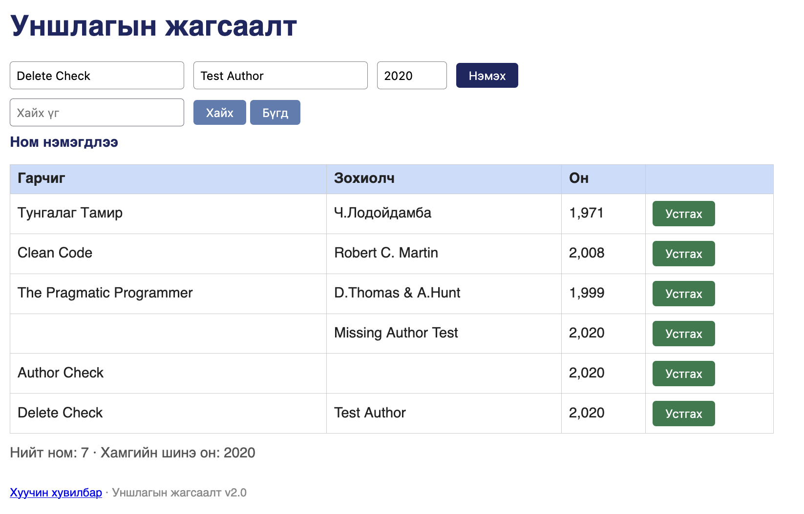
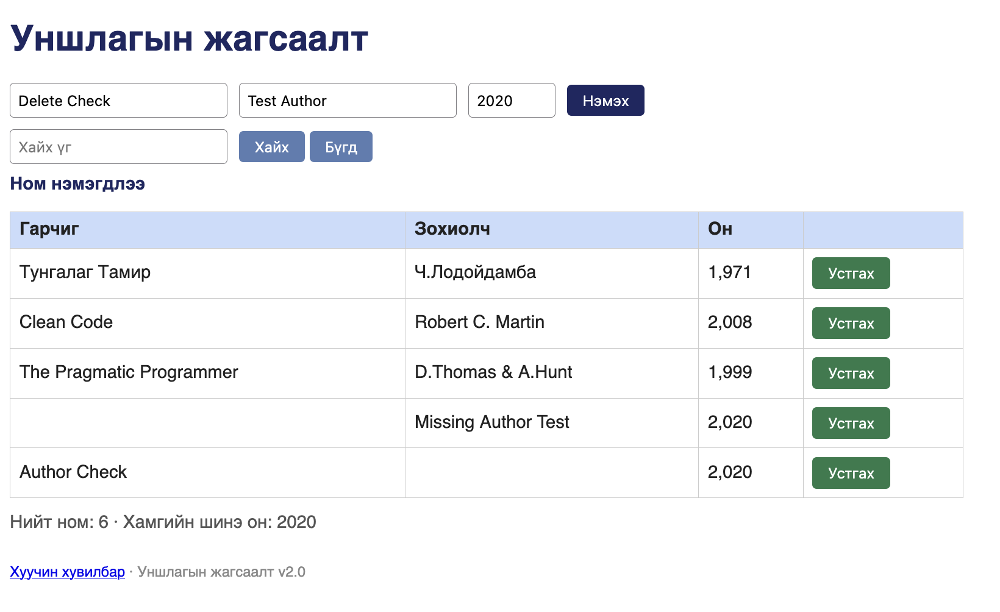

# BUG-04 — Ном устгасны дараа «Ном нэмэгдлээ» гэж мэдэгддэг

- **Ноцтой байдал:** Бага (Minor) — номын мөр устсан ч мэдэгдэл өөр үйлдлийг илэрхийлнэ.
- **Ангилал:** Хэрэглэгчийн интерфэйс, үйлдлийн мэдэгдэл
- **Аялал:** Supermodel

## Орчин

- Апп: «Уншлагын жагсаалт» v2.0
- Хөтөч: Firefox 160.0.1, macOS
- Дахин шалгасан огноо: 2026-11-25
- Хаяг: `http://localhost:3000`

## Дахин гаргах алхам

1. Аппыг шинээр асааж, анхны гурван номтой жагсаалтыг нээнэ.
2. «Гарчиг»-т `Delete Check`, «Зохиолч»-д `Test Author`, «Он»-д `2020` оруулаад «Нэмэх» товчийг дарна.
3. Шинэ номын мөрийн «Устгах» товчийг дарж, хүснэгтийн дээрх мэдэгдлийг шалгана.

## Хүлээгдсэн үр дүн

Сонгосон номын мөр арилж, «Ном устгагдлаа» гэх мэт тухайн үйлдэлд тохирсон мэдэгдэл харагдах ёстой.

## Бодит үр дүн

`Delete Check` номын мөр арилсан боловч «Ном нэмэгдлээ» гэсэн мэдэгдэл хэвээр харагдсан.

## Нотлох баримт

[Туршилтын тайлан, 22:54](../session-report.md) · [Өмнөх туршилтын зураг](../screenshots/delete-success.png)
