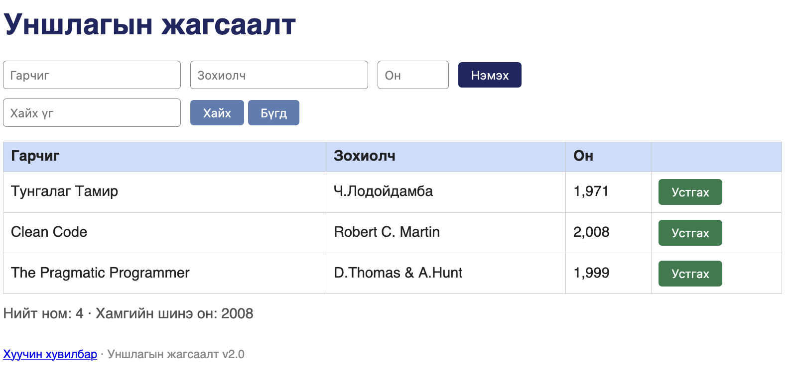

# BUG-05 — Гурван мөртэй жагсаалтын тоолуур дөрөв гэж харуулдаг

- **Ноцтой байдал:** Бага (Minor) — номын мөрүүд харагдаж байгаа ч нийт тоо буруу байна.
- **Ангилал:** Жагсаалтын тоолуур
- **Аялал:** Fed-Ex

## Орчин

- Апп: «Уншлагын жагсаалт» v2.0
- Хөтөч: Firefox 160.0.1, macOS
- Ажигласан огноо: 2026-11-25
- Хаяг: `http://localhost:3000`

## Дахин гаргах алхам

1. Аппыг шинээр асааж, жагсаалтыг нээнэ.
2. Гарчгийн мөрийг хасаж, хүснэгтэд харагдах номын мөрийг тоолно.
3. Мөрийн тоог хүснэгтийн доорх «Нийт ном» утгатай тулгана.

## Хүлээгдсэн үр дүн

Тоолуур хүснэгтэд харагдах номын мөрийн тоотой тэнцүү байна. Гурван номын мөртэй үед «Нийт ном: 3» гэж харагдах ёстой.

## Бодит үр дүн

Хүснэгтэд гурван номын мөр байсан ч «Нийт ном: 4» гэж харагдсан. 23:32 цагт аппыг шинээр асааж давтан шалгахад ижил зөрүү гарсан.

## Нотлох баримт

[Давтан шалгалтын зураг](../screenshots/bug-05-retest.png) · [Туршилтын тайлан, 22:37 ба 23:32](../session-report.md)
