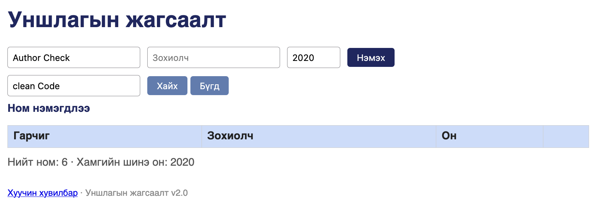
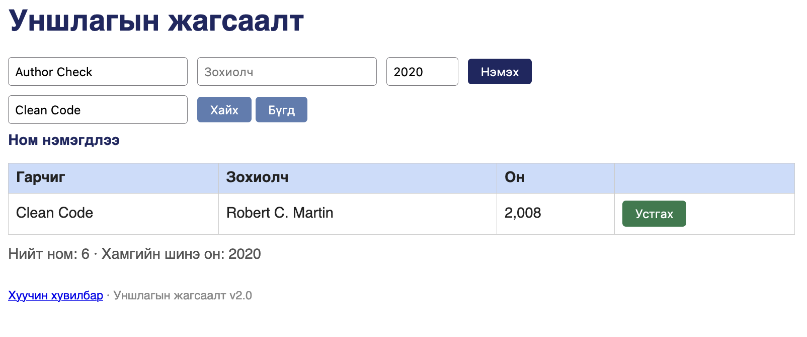
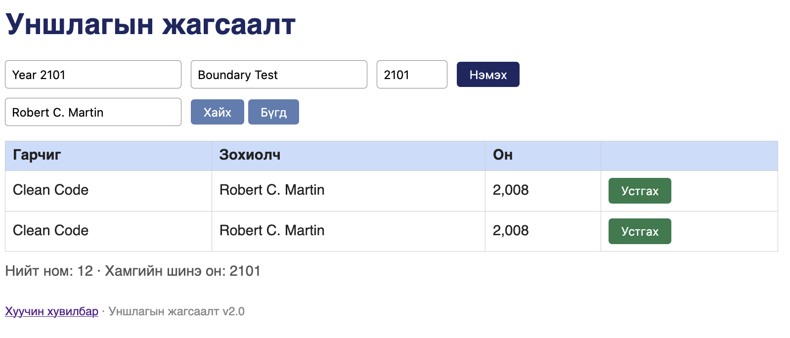
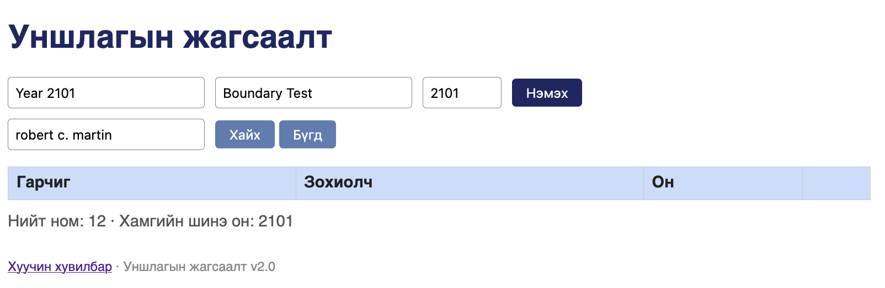

# BUG-06 — Гарчиг, зохиогчоор хайхад том жижиг үсэг ялгадаг

- **Ноцтой байдал:** Бага (Minor) — гарчиг эсвэл зохиогчийн нэрийг өөр том жижиг үсгээр бичихэд байгаа ном олдохгүй.
- **Ангилал:** Хайлтын ажиллагаа
- **Аялал:** Fed-Ex

## Орчин

- Апп: «Уншлагын жагсаалт» v2.0
- Хөтөч: Firefox 160.0.1, macOS
- Ажигласан огноо: 2026-11-25
- Хаяг: `http://localhost:3000`

## Дахин гаргах алхам

1. Аппыг шинээр асааж, анхны гурван номын дотор `Clean Code` байгааг шалгана.
2. «Хайх үг» талбарт `clean Code` гэж оруулаад «Хайх» товчийг дарна.
3. Хайлтын үгийг `Clean Code` болгож солиод «Хайх» товчийг дахин дарна.
4. `Robert C. Martin`, `robert c. martin` гэсэн зохиогчийн нэрийг тус тус хайж, гарсан мөрүүдийг харьцуулна.

## Хүлээгдсэн үр дүн

Апп гарчиг болон зохиогчийн нэрээр том жижиг үсэг ялгалгүй хайх ёстой. Хос хайлт бүрт `Clean Code` номын ижил мөрүүд гарах ёстой.

## Бодит үр дүн

`clean Code` гэж хайхад хүснэгтэд номын мөр гараагүй. `Clean Code` гэж хайхад тухайн номын нэг мөр гарсан.

Зохиогчийн нэрийг `Robert C. Martin` гэж хайхад тухайн үед жагсаалтад байсан `Clean Code`-ийн хоёр мөр гарсан. `robert c. martin` гэж хайхад нэг ч мөр гараагүй. Шинээр асаасан жагсаалтад `Clean Code`-ийн анхны нэг бүртгэл байна.

## Нотлох баримт

[Туршилтын тайлан, 22:51 ба 23:08](../session-report.md)
