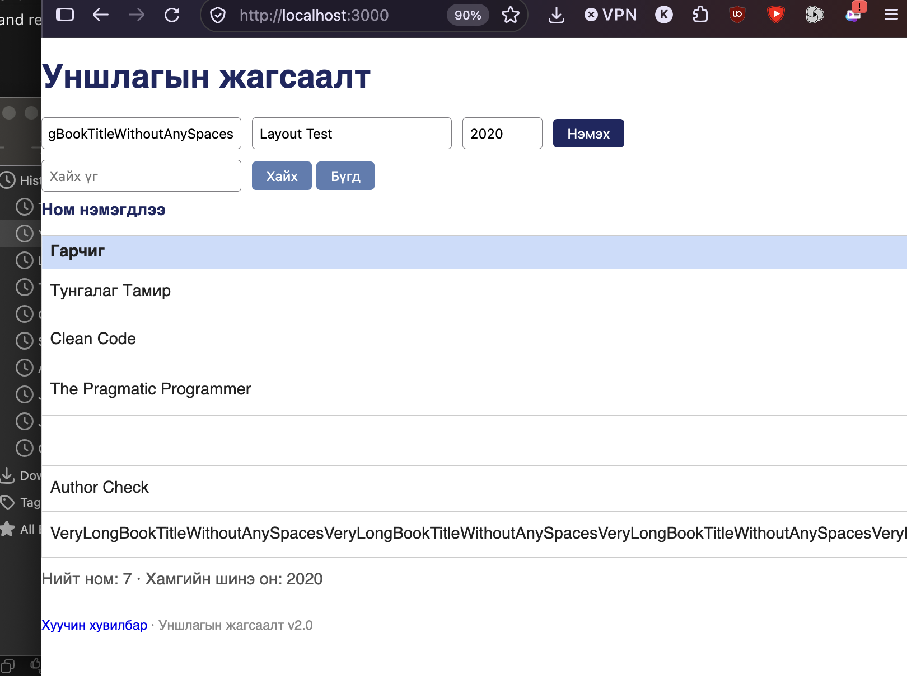

# BUG-07 — Зайгүй урт гарчиг хүснэгтийн багана, товчийг харагдах хэсгээс гаргадаг

- **Ноцтой байдал:** Бага (Minor) — нарийн цонхонд номын мэдээлэл болон устгах товчийг шууд харах боломжгүй.
- **Ангилал:** Хүснэгтийн харагдах байдал
- **Аялал:** Supermodel

## Орчин

- Апп: «Уншлагын жагсаалт» v2.0
- Хөтөч: Firefox 160.0.1, macOS, хуудасны томруулалт 90%
- Ажигласан огноо: 2026-11-25
- Хаяг: `http://localhost:3000`

## Дахин гаргах алхам

1. Аппыг шинээр асааж, анхны гурван номтой жагсаалтыг нээнэ.
2. «Гарчиг»-т `VeryLongBookTitleWithoutAnySpaces` гэсэн бичвэрийг зайгүй дөрвөн удаа залгаж оруулна. «Зохиолч»-д `Layout Test`, «Он»-д `2020` оруулаад «Нэмэх» товчийг дарна.
3. Firefox-ийн цонхыг ойролцоогоор тал өргөнтэй болтол нарийсгаж, хуудасны зүүн захаас хүснэгтийг харна.

## Хүлээгдсэн үр дүн

Урт гарчиг оруулсан ч хүснэгтийн зохион байгуулалт эвдрэхгүй, номын мэдээлэл болон «Устгах» товч харагдана.

## Бодит үр дүн

Урт гарчиг нэг мөрөнд үлдэж, «Гарчиг» багана цонхны өргөнөөс хэтэрсэн. Хүснэгтийн зүүн талаас харахад «Зохиолч», «Он» багана болон «Устгах» товч харагдаагүй.

## Нотлох баримт

[Өргөн цонхны зураг](../screenshots/long-title-layout.png) · [Туршилтын тайлан, 22:57 ба 22:58](../session-report.md)
