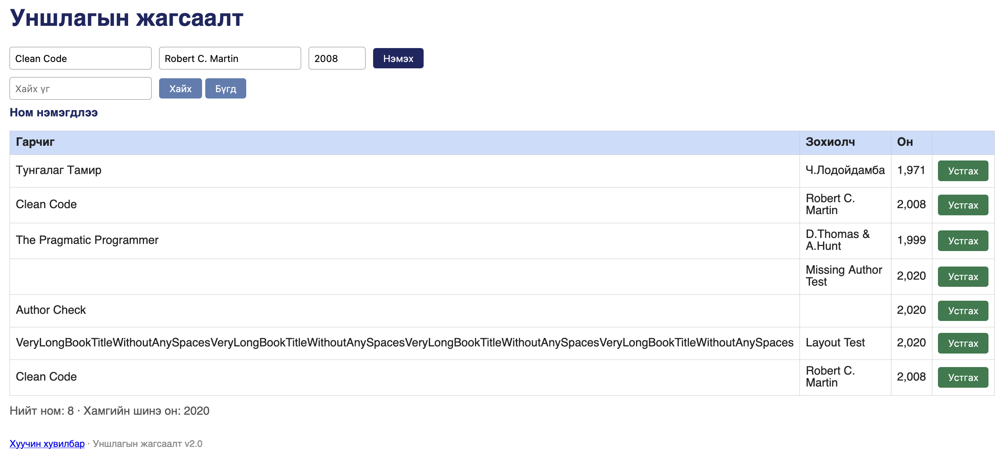

# BUG-08 — Ижил гарчиг, зохиогчтой ном дахин бүртгэгддэг

- **Ноцтой байдал:** Ноцтой (Major) — ижил номын хоёр бүртгэл үүсэж, жагсаалтын өгөгдөл давхарддаг.
- **Ангилал:** Оролтын баталгаажуулалт, өгөгдлийн бүрэн бүтэн байдал
- **Аялал:** Fed-Ex

## Орчин

- Апп: «Уншлагын жагсаалт» v2.0
- Хөтөч: Firefox 160.0.1, macOS
- Ажигласан огноо: 2026-11-25
- Хаяг: `http://localhost:3000`

## Дахин гаргах алхам

1. Аппыг шинээр асааж, анхны гурван номын дотор `Clean Code` байгааг шалгана.
2. «Гарчиг»-т `Clean Code`, «Зохиолч»-д `Robert C. Martin`, «Он»-д `2008` оруулна.
3. «Нэмэх» товчийг дарж, мэдэгдэл болон ижил номын мөрийн тоог шалгана.

## Хүлээгдсэн үр дүн

Апп ижил гарчиг, зохиогчтой номыг дахин бүртгэхээс татгалзаж, хүснэгтэд нэг `Clean Code` мөр үлдээх ёстой.

## Бодит үр дүн

Апп «Ном нэмэгдлээ» гэж мэдэгдсэн. `Clean Code` гарчигтай, `Robert C. Martin` зохиогчтой, `2008` онтой хоёр мөр харагдсан.

## Нотлох баримт

[Туршилтын тайлан, 22:59](../session-report.md)
