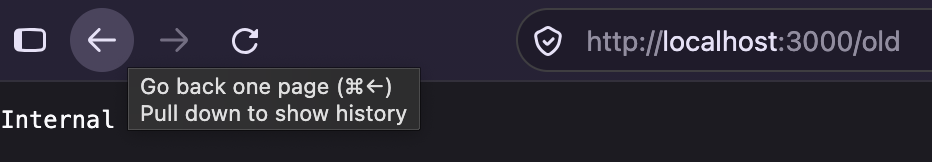

# BUG-09 — «Хуучин хувилбар» холбоос серверийн алдаа харуулдаг

- **Ноцтой байдал:** Бага (Minor) — хуучин хувилбарын хуудас нээгдэхгүй.
- **Ангилал:** Холбоосын ажиллагаа
- **Аялал:** Supermodel. HTTP хариуг Saboteur аяллаар давтан шалгав.

## Орчин

- Апп: «Уншлагын жагсаалт» v2.0
- Хөтөч: Firefox 160.0.1, macOS
- Ажигласан огноо: 2026-11-25
- Хаяг: `http://localhost:3000`

## Дахин гаргах алхам

1. Аппыг шинээр асааж, үндсэн жагсаалтыг нээнэ.
2. Хуудасны доод талын «Хуучин хувилбар» холбоосыг нээнэ.
3. Хөтчийн хаягийн мөр болон нээгдсэн хуудсыг шалгана.

HTTP төлөвийг шалгахдаа `curl -sS -i http://localhost:3000/old` тушаалыг ажиллуулна.

## Хүлээгдсэн үр дүн

Холбоосоор хуучин хувилбарын хуудас нээгдэнэ.

## Бодит үр дүн

Хөтөч `http://localhost:3000/old` хаяг руу шилжиж, «Internal Server Error» гэж харуулсан. `GET /old` хүсэлтийг `curl`-ээр давтан илгээхэд HTTP `500 Internal Server Error` төлөв болон `Internal Server Error` гэсэн текстэн хариу ирсэн.

## Нотлох баримт

[HTTP 500 хариуны бүрэн гаралт](../evidence/bug-09-curl.txt) · [Туршилтын тайлан, 23:04–23:05](../session-report.md)
